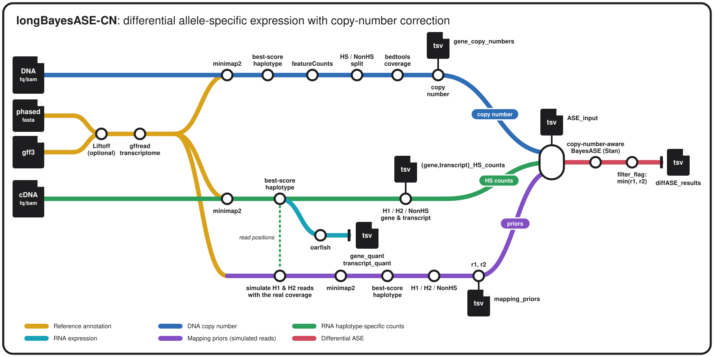

# longBayesASE-CN

[](https://www.nextflow.io/)
[](https://github.com/pabloangulo7/longBayesASE-CN/actions/workflows/ci.yml)
[](LICENSE)

`longBayesASE-CN` is a Nextflow pipeline for differential allele-specific expression (ASE) from long reads on a personalized haplotype-resolved assembly. It measures haplotype-specific RNA counts and DNA copy number and fits a copy-number-aware adaptation of BayesASE (León-Novelo et al., 2018), so that the differences it reports are those that gene dosage alone does not explain.

The pipeline needs:

- a haplotype-resolved FASTA whose contigs end in `_hap1` or `_hap2`;
- a GFF3 annotation of that assembly, or a source genome and annotation to lift over;
- a samplesheet;
- one or more contrasts, for example `Aneuploid:Control`.

## Workflow



## Quick start

Install Nextflow 24.10 or newer and use Docker, Singularity/Apptainer or Conda.

```bash
nextflow run pabloangulo7/longBayesASE-CN \
  -profile singularity \
  --samplesheet samples.tsv \
  --fasta assembly.fa \
  --gff3 assembly.gff3 \
  --contrast Aneuploid:Control \
  --outdir results
```

If the assembly is not annotated yet, replace `--gff3` with `--source_fasta GRCh38.fa --source_gff3 gencode.gff3` to lift the annotation over with Liftoff.

`--step all` (the default) runs every step. Add `-resume` to reuse finished work.

### Main parameters

| Parameter | Meaning |
|---|---|
| `--samplesheet` | Samples and their DNA/RNA files. |
| `--fasta` | Haplotype-resolved assembly. |
| `--gff3` | Annotation of the assembly. |
| `--source_fasta`, `--source_gff3` | Genome and annotation lifted over by Liftoff when there is no `--gff3`. |
| `--contrast` | Conditions to compare, `conditionA:conditionB`; several separated by commas. |
| `--level` | `gene` (default) or `transcript`: the features that are tested. |
| `--step` | `all` (default), `annotation`, `dna`, `rna` or `diffase`. |
| `--outdir` | Output directory (default `results`). |

### Samplesheet

```text
sample	condition	dna_id	rna	dna	ploidy
Sample1_R1	Control	Sample1	/data/Sample1_R1.fastq.gz	/data/Sample1.ubam	
Sample1_R2	Control	Sample1	/data/Sample1_R2.bam	/data/Sample1.genome.bam	
Sample2_R1	Aneuploid	Sample2	/data/Sample2_R1.fastq.gz	/data/Sample2.fastq.gz	chr7:2:1;chr22:1:2
```

| Column | Content |
|---|---|
| `sample` | Unique name of the RNA library. |
| `condition` | Group used in `--contrast`. |
| `dna_id` | DNA sample of the library; replicate libraries share it. |
| `rna` | cDNA FASTQ, uBAM, or BAM aligned to the diploid transcriptome. |
| `dna` | gDNA FASTQ, uBAM, or BAM aligned to the assembly. May be empty. |
| `ploidy` | Known copy number, `chromosome:CN_H1:CN_H2` separated by semicolons. Empty for a diploid sample. |

FASTQ and uBAM files are aligned with minimap2; a BAM is used as it is. Several raw files of one library can be separated by semicolons. `assets/samplesheet.example.tsv` is a template.

## Steps

### Annotation

```bash
nextflow run pabloangulo7/longBayesASE-CN -profile singularity \
  --step annotation --fasta assembly.fa --gff3 assembly.gff3 --outdir results
```

| Output | Content |
|---|---|
| `reference/diploid.gff3` | Annotation of both haplotypes. |
| `reference/diploid_transcriptome.fa`, `hap1_transcriptome.fa`, `hap2_transcriptome.fa` | Transcript sequences. |
| `reference/genes.bed`, `genes.saf`, `tx2gene.tsv` | Gene coordinates and transcript-to-gene map. |
| `reference/annotation_summary.tsv` | Per gene and haplotype: chromosome of the primary copy (`Chrom_H1`, `Chrom_H2`), copies, whether they fall on several chromosomes (`chr_diff_h1`, `chr_diff_h2`), length and exon differences, transcripts shared with the other haplotype (`min_tx_copies_h1`, `min_tx_copies_h2`), MANE (`MANE_h1`, `MANE_h2`, `MANE_tag`), and the classes `Set` and `Set2`. |
| `reference/transcriptome_summary.tsv` | Transcripts per gene. |
| `reference/liftoff/` | Liftoff output, when the annotation was lifted over. |

### DNA

```bash
nextflow run pabloangulo7/longBayesASE-CN -profile singularity \
  --step dna --samplesheet samples.tsv --fasta assembly.fa --gff3 assembly.gff3 --outdir results
```

| Output | Content |
|---|---|
| `dna/gene_copy_numbers.tsv` | Copy number of each haplotype per sample and gene (`sample`, `ID`, `Chrom_H1`, `Chrom_H2`, `CN_H1`, `CN_H2`). |
| `dna/copy_number.qc.tsv` | Diploid baseline and per-chromosome estimates. |
| `dna/counts/` | Reads per gene and read category, per sample. |
| `dna/coverage/` | Haplotype-specific and NonHS depth per gene, per sample. |

### RNA

```bash
nextflow run pabloangulo7/longBayesASE-CN -profile singularity \
  --step rna --samplesheet samples.tsv --fasta assembly.fa --gff3 assembly.gff3 --outdir results
```

| Output | Content |
|---|---|
| `rna/gene_HS_counts.tsv`, `rna/transcript_HS_counts.tsv` | H1, H2 and NonHS reads per library and feature. |
| `rna/ASE_input.gene.tsv` | Input of the differential ASE step: counts, copy number and priors per library and feature. |
| `rna/gene_quant.tsv`, `rna/transcript_quant.tsv` | Oarfish expression, both haplotypes summed, for differential expression and isoform usage. |
| `rna/counts/` | Reads per category and QC, per library. |
| `rna/oarfish/` | Oarfish output per library. |
| `priors/mapping_priors.gene.tsv` | `r1` and `r2` of each feature (see [Mapping priors](#mapping-priors)). |
| `priors/mapping_priors.gene.misassignment.tsv` | QC per feature: simulated reads per haplotype (`n_hap1`, `n_hap2`) and the fraction called on the wrong haplotype (`H1_misassignment`, `H2_misassignment`). |
| `priors/mapping_priors.gene.stats.tsv` | QC summary of the simulation: features with a prior, median priors and misassignment, and the fraction of the reads of each haplotype called H1, H2 and NonHS. |
| `priors/simulated_counts/` | Counts and QC of the reads simulated from H1 (`SIM_HAP1`) and H2 (`SIM_HAP2`), as `rna/counts/` for the real libraries. |

With `--level transcript` the priors and the ASE input are written per transcript (`mapping_priors.transcript.*`, `ASE_input.transcript.tsv`). The copy number in the ASE input comes from `--copy_number` or from the samplesheet `ploidy` column (1:1 where neither gives it).

### Differential ASE

From the ASE input of the RNA step:

```bash
nextflow run pabloangulo7/longBayesASE-CN -profile singularity \
  --step diffase \
  --ase_input results/rna/ASE_input.gene.tsv \
  --contrast Aneuploid:Control \
  --outdir results
```

Or from the three tables, each of which can be left out:

```bash
nextflow run pabloangulo7/longBayesASE-CN -profile singularity \
  --step diffase \
  --samplesheet samples.tsv \
  --hs_counts results/rna/gene_HS_counts.tsv \
  --copy_number results/dna/gene_copy_numbers.tsv \
  --priors results/priors/mapping_priors.gene.tsv \
  --fasta assembly.fa --gff3 assembly.gff3 \
  --contrast Aneuploid:Control \
  --outdir results
```

| Input | Without it |
|---|---|
| `--hs_counts` | Required unless `--ase_input` is given. |
| `--copy_number` | Taken from the samplesheet `ploidy` column, and 1:1 where that is empty (needs `--gff3`). |
| `--priors` | Simulated from the RNA libraries of the samplesheet (needs `--fasta` and `--gff3`). With `-resume` and the work directory of the RNA step, the alignments are reused. |

| Output | Content |
|---|---|
| `diffase/diffASE_results.tsv` | One row per feature and contrast (see [Result columns](#result-columns)). |
| `diffase/ASE_input.gene.tsv` | The model input, when this step builds it. |
| `priors/` | The priors and their QC, when this step simulates them. |

The small table in `examples/toy_ase/` runs the step without sequencing data:

```bash
nextflow run . -profile conda --step diffase \
  --ase_input examples/toy_ase/ASE_input.tsv --contrast Treatment:Control --outdir toy_results
```

## Optional parameters

| Parameter | Default | Purpose |
|---|---:|---|
| **DNA** | | |
| `--copy_number_level` | `chromosome` | `chromosome` gives every gene the median of its chromosome; `gene` estimates each gene from its own depth (noisier). |
| `--gene_copies` | `primary` | `primary` uses only the canonical locus of a gene; `all` adds the depth of every copy Liftoff annotated. |
| `--cn_change_threshold` | `1.2` | Fold change from the diploid baseline, up or down, that marks a chromosome as gained or lost. |
| `--min_haplotype_depth` | `10` | Minimum haplotype-specific depth of a gene to split its copy number between H1 and H2 from its own reads; below it, the gene takes the H1/H2 proportion of its chromosome. |
| `--min_gene_depth` | `1` | Minimum total depth of a gene to estimate its own copy number with `--copy_number_level gene`. |
| **RNA** | | |
| `--rna_strand` | `fw` | Orientation of the reads on their transcript: `fw` for oriented ONT cDNA, `rc` or `both`. |
| `--oarfish_score` | `0.99999` | Fraction of the best alignment score an alignment needs to be used by Oarfish. Do not use exactly `1`: rounding then drops about 11% of the reads. |
| `--oarfish_bootstraps` | `0` | Oarfish inferential replicates, for uncertainty-aware transcript analyses. |
| `--prior_reads` | `2000` | Reads per feature, split among the libraries, whose positions are used to simulate the priors. |
| `--min_prior_reads` | `10` | Minimum simulated reads per haplotype for a feature to get a prior. |
| **diffASE** | | |
| `--min_prior` | `0.01` | Features with `min(r1, r2)` at or below this are flagged `low_prior`. |
| `--ase_shards` | `100` | Groups of features fitted in parallel, per contrast. |
| `--ase_iterations` | `100000` | Stan iterations per feature. |
| `--ase_warmup` | `10000` | Stan warmup iterations. |
| `--seed` | `1701` | Stan random seed. |
| **Resources** | | |
| `--max_cpus`, `--max_memory`, `--max_time` | `16`, `120.GB`, `72.h` | Upper limits for one process. |

For a Slurm cluster add `-profile singularity,slurm`.

## Method

### Haplotype-specific counts

A read is H1 or H2 when all its best-scoring alignments fall on one haplotype, and NonHS when both haplotypes explain it equally well. Reads whose best alignments fall on several features are left out of the model. A read compatible with several isoforms of a gene counts at gene level but not at transcript level.

### Copy number

DNA reads are classified in the same way. Only genes with a single annotated copy per haplotype (Singletons) set the diploid baseline and the chromosome medians. For each chromosome, the total copy number is the median depth of its Singletons over the baseline, and it is split into `CN_H1` and `CN_H2` with the median H1 share of their haplotype-specific depth; a chromosome within `--cn_change_threshold` of diploid is kept at 1:1.

Each allele of a gene takes the copy number of the homologue it lies on: `CN_H1` that of the H1 copy of `Chrom_H1`, and `CN_H2` that of the H2 copy of `Chrom_H2`, the chromosomes of the primary copy Liftoff placed on each haplotype. They differ for genes whose primary copies lie on different chromosomes, mostly in segmental duplications; a gene annotated on one haplotype only takes that chromosome for both. At transcript level, every transcript takes the copy number of its gene.

### Mapping priors

`r1` and `r2` are the probabilities that a read from H1, or from H2, is recognised as haplotype-specific. They depend on whether the read covers a heterozygous site, so on the isoforms and read positions of each feature. For a sample of the real reads, the same interval is cut from the H1 and the H2 copy of its transcript, which replicates the read coverage of each feature on both haplotypes. These simulated reads are aligned and classified like the real ones: `r1` is the fraction of H1 reads called H1, and `r2` the same for H2. The fraction called on the wrong haplotype is reported for QC only; the model assumes it is negligible. Only read positions are used, pooled over the libraries, so all conditions share the same priors.

### Model

For each feature and condition:

```text
E[H1]    = CN_H1 × r1 × beta / alpha
E[H2]    = CN_H2 × r2 × beta × alpha
E[NonHS] = [CN_H1 × (1 - r1) / alpha + CN_H2 × (1 - r2) × alpha] × beta
theta    = 1 / (1 + alpha²)
thetaRaw = CN_H1 × theta / (CN_H1 × theta + CN_H2 × (1 - theta))
```

`theta` is the H1 share of expression per copy: 0.5 when expression follows dosage. `thetaRaw` is the H1 share of total expression, as seen in the reads. On a chromosome with `CN_H1=2`, a gene that follows its dosage has `theta=0.5` and `thetaRaw=2/3`.

The priors are those of BayesASE: `alpha ~ lognormal(0, 0.5)`, a gamma hierarchy for library size `beta`, and inverse-gamma(2.01, 0.05) overdispersion. Each feature is fitted on its own with Stan (one chain). Where a group has no read in a category, one read is added to its best-covered library, as in BayesASE, to keep `alpha` finite.

Every feature is fitted. `filter_flag` is `low_prior` when `min(r1, r2) <= --min_prior`, and `pass` otherwise: in a `low_prior` feature few reads of one haplotype cover a heterozygous site, so its counts barely inform `alpha`, and a small error in `r1` or `r2` becomes a large error in the bias correction `r1/r2`.

### Tests

`diffAI_pvalue` is the evidence value of BayesASE:

```text
diffAI_pvalue = 2 × min{ P(alpha_A > alpha_B), P(alpha_A < alpha_B) }
```

It is the smallest level at which the central credible interval of `alpha_A - alpha_B` excludes 0. It is computed per feature, as in BayesASE, without multiple-testing correction. When every draw falls on one side, it is reported as `1/draws` with the flag `pvalue0`.

`rope_value` is the posterior probability that `|theta_A - theta_B|` is smaller than the effect that full dosage compensation would have. That effect is computed per feature and per draw: it is the change in `theta` if group A kept the `thetaRaw` of group B despite its own copy number. When both groups have the same H1:H2 ratio, the effect of a 2:1 gain (averaged over gains of H1 and of H2) is used instead. A high `rope_value` therefore means that any difference between the groups is smaller than dosage compensation would produce.

### Result columns

| Columns | Meaning |
|---|---|
| `test`, `groupA`, `groupB` | Contrast; `groupA` is the first condition in `--contrast`. |
| `groupX_CN_H1`, `groupX_CN_H2` | Mean copy number of each haplotype in the group. |
| `groupX_priorH1`, `groupX_priorH2` | Mapping priors `r1`, `r2`. |
| `groupX_totalH1/H2/NonHS`, `groupX_meanH1/H2/NonHS` | Reads per category, summed and averaged over libraries. |
| `groupX_alpha_mean` | Posterior mean of `alpha`. |
| `groupX_theta_mean`, `_q025`, `_q975` | `theta` with its 95% credible interval. |
| `groupX_thetaRaw_mean`, `_q025`, `_q975` | `thetaRaw` with its 95% credible interval. |
| `groupX_alphaAI_pvalue`, `groupX_thetaAI_pvalue` | Evidence of allelic imbalance within the group (`alpha≠1`). |
| `delta_theta_mean`, `delta_thetaRaw_mean`, `delta_alpha_mean` | Differences between groups, A minus B. |
| `diffAI_pvalue` | Evidence of differential allelic imbalance, corrected by copy number. |
| `rope_value` | Probability that the difference in `theta` is smaller than full dosage compensation. |
| `analysis_flag` | `Success`, `pvalue0`, `Skipped_Low_Counts`, or the error. |
| `filter_flag` | `pass` or `low_prior` (see [Model](#model)). |

## Citation

The differential ASE model is adapted from:

- León-Novelo L. et al. (2018), *Direct Testing for Allele-Specific Expression Differences Between Conditions*, G3. [doi:10.1534/g3.117.300139](https://doi.org/10.1534/g3.117.300139)
- Miller B.R. et al. (2021), *Testcrosses are an efficient strategy for identifying cis-regulatory variation: Bayesian analysis of allele-specific expression (BayesASE)*, G3. [doi:10.1093/g3journal/jkab096](https://doi.org/10.1093/g3journal/jkab096)

Also cite the tools used in your run: Liftoff, gffread, minimap2, samtools, bedtools, featureCounts, Oarfish, Stan/RStan and Nextflow.

## License

MIT. See [LICENSE](LICENSE).
